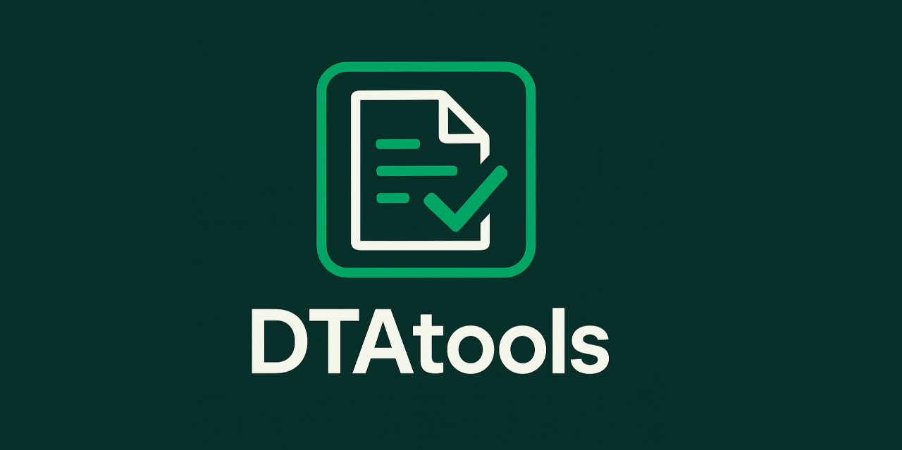
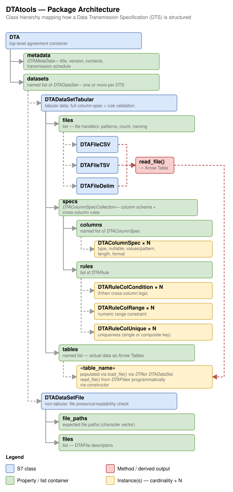

# DTAtools R-Package

<!-- badges: start -->

[](https://github.com/Boehringer-Ingelheim/DTAtoolsR/actions/workflows/R-CMD-check.yaml)

<!-- badges: end -->



**Data Transmission Agreements (DTAs)** and **Data Transmission Specifications
(DTS)** play a pivotal role in the secure and compliant exchange of data
between stakeholders — such as research organizations or vendors working with
pharma companies — particularly in clinical or regulatory environments where
data integrity and specification adherence are critical. However, manually
validating these data transmissions is error-prone and time-consuming, leading
to repeated submissions and significant time loss.

`DTAtools` streamlines the management of DTAs/DTS end to end. Specifications
are stored in human-readable **YAML**, offering flexibility and compatibility
across DTA/DTS scenarios. The package validates tabular data against those
specifications — types, nullability, allowed values, regex patterns, and
cross-column logic — and can also confirm that expected deliverable files were
received, are non-empty, and are readable.

`DTAtools` is open-sourced by Boehringer Ingelheim to give external and
internal collaborators an easy tool to validate data before transmission,
following the DevOps principle of detecting errors fast and automatically.

📖 **For a comprehensive walkthrough of every feature, see the
[full package vignette](vignettes/DTAtools.Rmd)** (`vignette("DTAtools")`
once installed).

## Features

- Import/export DTA/DTS specifications from/to YAML and Word documents
- Columns are read in the type the specification declares for them, so
  `"007"` in a text column stays `"007"`
- Reads delimited text (CSV, TSV, any single-character separator, plain or
  gzip-compressed), SAS datasets (`.sas7bdat`) and SAS transport files (`.xpt`),
  the last two via the haven package; delivered loose, in `.zip` archives or in
  SAS transport libraries (`load_delivery()`)
- Comprehensive validation of tabular data: type, format, nullability,
  allowed values, and regex patterns
- Cross-column rule validation (`col_condition`, `col_range`,
  `col_unique`, `group_condition`)
- Matrix validation (`type: matrix`, `DTADataSetMatrix`) for omics count and
  genotype matrices: header, row labels, dimensions and every cell
- File-presence validation (`DTADataSetFile`) for non-tabular deliverables
- Detailed, queryable validation results (`results()`, `messages()`,
  `inspect()`, `explain_messages()`)
- Export validated tables to disk with optional compression and MD5
  checksums
- Generate Word documentation tables directly from specifications, or the
  whole agreement as a document (`write_dta()`)
- Generate a standalone, self-contained HTML validation report
  (`write_validation_report()`) with a sortable, filterable, click-to-inspect
  message table
- An interactive Shiny application over the same objects (`run_dta_app()`)

## Installation

For now, it is only possible to install the development version from GitHub:

```r
remotes::install_github("Boehringer-Ingelheim/DTAtoolsR")
```

## Quickstart

```r
library(DTAtools)

# 1. Load a full DTA/DTS definition from YAML
#    (metadata + dataset specs + file handlers + rules — all in one file)
dta_file <- system.file("extdata", "clinical_dta.yaml", package = "DTAtools")
dta <- read_dta_from_yaml(dta_file)

# 2. Load the data file into the dataset defined in the YAML
csv_path <- system.file("extdata", "clinical_data.csv", package = "DTAtools")
dta <- load_file(dta, dataset = "clinical_data", file = csv_path)

# 3. Validate — check() runs import, column spec and rule validation for all datasets
dta <- check(dta)

# 4. Summarise results (one row per table)
results(dta)
```

Not every delivery needs a full DTA with metadata. When you only need to
validate *one* dataset, read the dataset definition directly with
`read_dataset_from_yaml()` — a standalone dataset YAML has the same shape as
one entry under a DTA's `datasets:` list (`id`, `type`, `name`,
`description`, `files`, `columns`, `rules`), just without the surrounding `metadata:` wrapper:

```r
# dataset.yaml has: id, type, name, description, files, columns, rules — no top-level metadata
ds <- read_dataset_from_yaml("dataset.yaml")

ds <- load_file(ds, file = csv_path, handler_index = 1)
ds <- check(ds)
results(ds)
```

## The Three Validation Axes

Validation reports on three independent axes. A failure on any one of them
fails the table, and `results()` counts each separately:

| Axis                     | Column            | What it means                                                      |
|--------------------------|-------------------|--------------------------------------------------------------------|
| **Schema** errors        | `n_columnspec_errors` | A value breaks a column constraint: type, `nullable`, `values`, `pattern`, `length` |
| **Rule** errors          | `n_rule_errors`   | A row breaks an inter-column rule: `col_condition`, `col_range`, `col_unique`, `group_condition` |
| **Import** errors        | `n_import_errors` | A value cannot be represented in the type its column declares      |

An **import error** is raised when a value is present in the source but does
not fit its declared type — the text `"unknown"` in a `SAS Num` column, for
example. The stored value becomes `NA`, the column keeps its declared type,
and the original text is retained and reported. **Any import error makes
validation fail**, on its own, even when every column spec constraint and every
rule passes.

```r
# AGE is declared numeric and permits missing values, so nothing here breaks
# the column spec and there are no rules at all — yet the table fails.
specs_imp <- DTAColumnSpecCollection(columns = list(
  SUBJECT_ID = DTAColumnSpec(id = "SUBJECT_ID", type = "SAS Char", nullable = FALSE),
  AGE        = DTAColumnSpec(id = "AGE",        type = "SAS Num",  nullable = TRUE)
))

ds_imp <- DTADataSetTabular(
  id     = "import_demo",
  specs  = specs_imp,
  tables = list(demo = data.frame(SUBJECT_ID = c("SUBJ0001", "SUBJ0002"),
                                  AGE        = c("34", "unknown")))
)
ds_imp <- check(ds_imp, quiet = TRUE)

validation_status(ds_imp)[, c("ok", "n_columnspec_errors",
                              "n_rule_errors", "n_import_errors")]
#>      ok n_columnspec_errors n_rule_errors n_import_errors
#> 1 FALSE               0             0               1

msgs <- messages(ds_imp)
msgs[msgs$source == "import", ]        # which values did not fit

# `import_raw` holds the original text; `import_reason` says why it did not fit
inspect(ds_imp, id = msgs$id[msgs$source == "import"][1])

as.data.frame(get_table(ds_imp, "demo"))   # the offending cell is now NA
```

> `check()` on an in-memory table prints a per-axis console report for all three
> passes, including a "validating imports" heading that names the row, column
> and raw text of each value that did not fit. The streaming path does not print
> an import heading, so when a streamed table fails with no visible reason, read
> `n_import_errors` from `results()` or filter `messages()` on
> `source == "import"`.

See the [vignette's Import Errors
section](vignettes/DTAtools.Rmd) for the full treatment.

## Package Architecture

`DTAtools` organises objects into a layered hierarchy that maps directly to
how a Data Transmission Specification (DTS) is structured — a top-level `DTA`
holding metadata and one or more datasets, each either fully-validated
tabular data (`DTADataSetTabular`), an omics matrix (`DTADataSetMatrix`) or a
simple file-presence check (`DTADataSetFile`):

<p align="center">
  
</p>

<details>
<summary>Plain-text version (ASCII)</summary>

```
DTA                              ← top-level agreement container
├── metadata                     ← title, version, receiver/supplier
|   (DTAMetaData)                     contacts, transmission schedule, ..
│
└── datasets (named list of DTADataSet)  ← one or more datasets per DTS
    │
    ├── DTADataSetTabular        ← tabular data: for tables with
    |   |                            full column-spec + rule validation
    │   ├── files (list)         ← expected file handlers for various
    |   |   |                        input types, manage file names,
    │   │   ├── DTAFileCSV           which can have patterns,
    |   |   ├── DTAFileTSV           number of files, etc ..
    |   |   ├── DTAFileDelim
    |   |   ├── DTAFileSAS7BDAT
    |   |   └── DTAFileXPT       (a DTAFileSAS7BDAT subclass)
    |   |   read_file(handler, file)  → Arrow Table
    |   |
    │   ├── specs (DTAColumnSpecCollection)  ← column-level specs +
    |   |   |                                   cross-column rules
    │   │   |
    │   │   ├── columns (named list of DTAColumnSpec)
    |   |   |   └── DTAColumnSpec × N   ← one per column: type, nullable,
    │   │   │                            values/pattern, length, format
    |   |   └── rules (list of DTARule)
    │   │       ├── DTARuleColCondition × N  ← if/then cross-column logic
    │   │       ├── DTARuleColRange × N      ← numeric range constraint
    │   │       └── DTARuleColUnique × N     ← uniqueness (single or
    |   |                                              composite key)
    |   |
    │   └── tables (named list)  ← actual data as Arrow Tables
    │       └── <table_name>     ← populated via load_file() or constructor
    │
    ├── DTADataSetMatrix         ← omics matrix (DTADataSetTabular subclass):
    |                                row_labels + header/rows/cells, no
    |                                per-column specs
    │
    └── DTADataSetFile           ← non-tabular: file presence/readability check
        ├── file_paths           ← bound file paths (via load_file() or paths=)
        └── files (list)         ← DTAFileAny descriptors (type: any), which
                                          may restrict the allowed endings
```

</details>

**Validation flow**, regardless of which object type you use:

1. `load_file(dta, dataset, file)` — reads a file into the dataset using its
   file handler, typing each column as the specification declares it
2. `check(dta)` / `check(ds)` — runs the import, column spec and rule checks; always
   returns the updated object
3. `results(x)` — one-row-per-table summary (pass/fail, per-axis error counts)
4. `messages(x)` — one-row-per-error detail table (`source`, column, row, rule,
   message, `id`)
5. `inspect(x, id = N)` — deep-dive into a specific error message by its `id`
6. `explain_messages(x)` — the same findings in plain language: what each value
   should have been and what it was

📖 See the [vignette's Package Architecture section](vignettes/DTAtools.Rmd) for the fully annotated diagram plus a node-by-node explanation.

## Usage

### Load specifications and datasets from YAML

Specifications are stored in the human- and machine-readable YAML format. A
specification contains definitions of:

- **columns:** column names, types, and optionally patterns or allowed
  values. See [YAML Column Format](#yaml-column-format).
- **rules:** cross-column logic, e.g. "if column A is empty, column B must
  contain a value". See
  [YAML Schema Rule Specification](#yaml-schema-rule-specification).
- **metadata:** DTA/DTS metadata — title, version, contacts, transmission
  schedule. See [YAML Metadata](#yaml-metadata).

There are three ways to bring a specification into R, from most to least
common:

1. **A full DTA/DTS document** (`metadata:` + one or more `datasets:`) —
   `read_dta_from_yaml()`. The recommended entry point for production use;
   see the [Quickstart](#quickstart) above.
2. **A single, self-contained dataset definition** (`id`, `type`, `files`,
   `columns`, `rules` — no top-level `metadata:`) — `read_dataset_from_yaml()`.
   Ideal when you only need to validate one dataset, e.g. while iterating on
   a spec. Also shown in the [Quickstart](#quickstart) above.
3. **A bare list of column specs** (just `columns:` plus optional `rules:`,
   no `id`/`type`/`files`) — `import_specs_from_yaml()`. The most manual
   option: you build the `DTADataSetTabular` wrapper yourself.

```r
# Use case 3: bare specs only — you supply name/type/data yourself
specs <- import_specs_from_yaml("spec.yaml")
```

### Load and validate tabular data

Create a `DTADataSetTabular` object from column specs and one or more data
tables. `check()` validates every table on all three axes and returns the
updated object — always assign the result back.

```r
col1  <- DTAColumnSpec(id = "STUDYID", type = "SAS Char", nullable = FALSE)
col2  <- DTAColumnSpec(id = "VISIT",   type = "SAS Char", nullable = TRUE)
specs <- DTAColumnSpecCollection(columns = list(STUDYID = col1, VISIT = col2))

table <- data.frame(STUDYID = c("1234", "1234"), VISIT = c("V01", "V02"))
data_obj <- DTADataSetTabular(id = "my_dataset", specs = specs,
                              tables = list(my_table = table))
data_obj <- check(data_obj)

results(data_obj)   # one row per table: status + per-axis error counts
messages(data_obj)  # one row per error: source, column, row, rule, message, id
```

`check()` also takes `force` (revalidate even when nothing changed),
`persist` and `artifact_dir` (where per-table validation artifacts are
written), `quiet`, and `tables` (restrict to named or indexed tables;
`datasets` on a `DTA`).

### Compressed input

A gzipped data file is read exactly like an uncompressed one. Arrow
decompresses `.gz` on the fly, and a specification that declares `data.csv` is
satisfied by `data.csv.gz` — compression is a transport detail, so the YAML
never has to mention it:

```r
# The handler declared in the YAML is `clinical_data.csv`.
dta <- read_dta_from_yaml(system.file("extdata", "clinical_dta.yaml", package = "DTAtools"))
dta <- load_file(dta, 1, file = "clinical_data.csv.gz")   # accepted
dta <- check(dta, quiet = TRUE)
```

The results are identical to validating the uncompressed file, including row
numbers, and `validate_file_stream()` still reads a compressed file in batches
rather than expanding it into memory. An anchored filename pattern such as
`^clinical_data\.csv$` matches the gzipped form too.

### SAS datasets (.sas7bdat)

A SAS dataset is declared like a delimited file, with `type: sas7bdat`, and
validated against the same column specifications. The file is decoded by the
haven package, which `DTAtools` depends on, so nothing extra has to be
installed:

```yaml
datasets:
  - id: adverse_events
    type: tabular
    files:
      type: sas7bdat
      filename: ae.sas7bdat
    columns:
      - id: USUBJID
        type: SAS Char
        nullable: false
      - id: ASTDT
        type: SAS Date
        format: SAS DATE9.
        nullable: true
```

```r
dta <- read_dta_from_yaml("spec.yaml")
dta <- load_file(dta, "adverse_events", file = "ae.sas7bdat")   # or ae.sas7bdat.gz
dta <- check(dta, quiet = TRUE)
results(dta)
```

What the reader hands to the validation, and what that means for a spec:

- Values are checked as stored. A blank character value is missing; trailing
  blanks are not part of a value (SAS pads them), but leading blanks, leading
  zeros and non-ASCII characters are kept. The text `NA` is a value, unlike in
  a CSV file, where it is read as missing.
- Column names are exactly as stored, upper and lower case included. A file
  with duplicate column names is refused.
- SAS dates, datetimes and times are numbers in the file. A column carrying a
  SAS date, datetime or time format arrives as the display text of the format
  the specification declares (`15AUG2025` under `DATE9.`), or as ISO 8601 text
  (`2025-08-15`, `2025-08-15T14:30:00`, `14:30:00`) when no matching format is
  declared. Declared as any non-date type (`SAS Num`, `SAS Int`), the column
  stays the SAS number itself: days (dates) or seconds (datetimes, times) since
  1960-01-01. A date stored without a SAS date format cannot be told from any
  other number, so it arrives as a number, and a `SAS Date` declaration then
  fails.
- Do not declare `length` on a SAS date, datetime or time column. It is checked
  against the text above, and the `length: 8` that `PROC CONTENTS` reports for
  the 8-byte numeric storage would fail every row.
- A type that does not match the data (a numeric column declared `SAS Char`, a
  fraction under `SAS Int`, a date column declared `SAS DateTime`) is a
  column-spec type violation, not an import error: the file stores numbers as
  numbers, so there is nothing to parse. The one exception is text in a column
  declared `SAS Num` or `SAS Int`: that text is parsed, as in a CSV file, and a
  value that does not parse is an import error. A column declared `SAS Int`
  holds a double, so a whole number passes and a fraction, or a value outside
  the 32-bit integer range, is a type violation.
- Numeric values under a `w.d` display format are checked as stored, not
  rounded to how SAS would display them.
- The dataset is always read into memory, with about three times its size as the
  peak. `stream = "auto"` reads it whatever its size and, when the size alone
  would have streamed it, says so in a message (class
  `dta_sas7bdat_in_memory`); `stream = "always"` is refused. A file near the
  1 GB upload limit of the app can exhaust the memory of a server process.
  `validate_file_stream()` and `cache_as_parquet()` are for delimited text
  only and refuse a SAS dataset, pointing to `load_file()`.
- A `.sas7bdat.gz` needs no separate decompression step, and `ae.sas7bdat` also
  matches it. haven unpacks it to a temporary file in `tempdir()`, of the
  uncompressed size, which is removed at garbage collection.
- The format catalog (`.sas7bcat`) is not read. Ship it as a `type: file`
  deliverable.

### Deliveries in containers (.zip, SAS transport .xpt)

A delivery often arrives as one `.zip`, or as one SAS transport library
(`.xpt`) holding several datasets. `load_delivery()` takes either, loose files,
or a mix, and routes every file by name to the datasets whose file entries
match it, exactly as if the files had been delivered loose:

```r
dta <- load_delivery(dta, "sdtm.zip")
dta <- load_delivery(dta, "sdtm.xpt")
attr(dta, "last_delivery") # what was loaded, opened, unused, ignored, refused or ambiguous
```

A library is split into one file per member, named after the member in lower
case: member `AE` is offered as `ae.xpt`, which an entry `filename: ae.xpt`
with `type: xpt` takes. A `.zip` or `.xpt` that a `type: any` entry takes as a
deliverable, by its name or because its `extensions` list `zip` or `xpt`, stays
one file and is not opened, unless an entry declares it as its container.

**The `containers:` section.** An agreement names its containers once, at
document level, and file entries refer to them:

```yaml
containers:
  - id: sdtm
    filename: "STUDY_SDTM_*.zip"   # * and ? are wildcards; letter case must match
    description: All SDTM domains as SAS transport files.   # shown in exported agreements
    default: true                  # every entry without a container of its own belongs here
  - id: adam
    filename: adam.zip
datasets:
  - id: adsl
    files:
      filename: adsl.xpt
      type: xpt
      container: adam              # a container id
  - id: define
    files:
      filename: define.pdf
      type: any
      container: none              # needs no container: exempt from the default
```

In R the section is `DTA(containers = list(DTAContainer("sdtm", "STUDY_SDTM_*.zip")))`.
`container_assignments(dta)` lists where every file entry must arrive.

- **Ids and file names.** A reference without a dot is a container id and must
  name a container of the document. A reference with a dot is a file name
  (`container: sdtm.zip`, as in 0.27.0): it resolves to the container with that
  file name, otherwise it declares one, so a specification without a
  `containers:` section works unchanged. Prefer the id: renaming the archive is
  then one edit, in the container.
- **The default container.** `default: true` (at most one container) makes every
  entry without its own reference belong to that container, datasets added
  later included: "everything arrives in the zip". `container: none` exempts
  an entry, e.g. a `define.pdf` sent separately.
- An entry belongs to at most one container.

**Individual checks.** Every dataset and every file can be checked on its own,
while the supplier is still producing the rest. A file that is not inside its
container is still loaded and its content validated. Packaging is a verdict of
its own: `container_findings(dta)` lists every file that is not known to be
inside the container its entry requires, and `check()` shows it beside the
content verdict:

| Finding | When | Verdict |
| --- | --- | --- |
| `outside` | delivered with `load_delivery()` loose, or inside another container | Validation FAILED |
| `unverified` | loaded on its own with `load_file()` (the individual check) | Validation INCOMPLETE |
| `unrecorded` | no record of how it arrived (a table assigned to `@tables`) | Validation INCOMPLETE |

So `ae.xpt` checked alone reports "content passed, packaging not verified",
while loose files delivered where the agreement requires a zip fail. Nothing
says PASSED while a finding exists. `check()` can therefore fail or be
incomplete on packaging alone; `validation_status()` of a dataset still judges
content only. `load_file()` refuses a `.zip` (or an `.xpt` the dataset's entry
does not read) and points to `load_delivery(x, files, datasets = "<id>")`.

**Ambiguity and `route`.** Containers rank an entry instead of excluding it: a
file that fits an entry's container wins over one that does not, and a misfit
is taken only when nothing ranks higher. When the same-rank candidates are
pattern entries of several datasets, the file is not guessed: it is not loaded,
`last_delivery` has the status `ambiguous` with the `candidates`, and you
choose with `route`, a named list from file name to dataset id
(`character(0)` loads it nowhere). The app asks with a table instead. Two
datasets that name the same file literally both get it.

```r
dta <- load_delivery(dta, files, route = list("lb_supp.csv" = "lb_supp"))
```

**`datasets`.** `load_delivery(dta, "sdtm.zip", datasets = c("ae", "dm"))` loads
only those datasets' files from the delivery (the rest are `unused`, and only
the chosen files are extracted). This is what dropping an archive on one
dataset's upload zone in the app does.

**File names must not overlap across datasets.** An agreement in which one file
name could belong to two datasets is ambiguous. `file_name_conflicts(dta)` lists
pattern entries of different datasets that take the same file, with an example
file name; `lint_dta()` reports `file_name_conflict` as a warning,
`validate_template()` fails a template that has one, and the app refuses an
edit that introduces one. For `^lb.*[.]csv$` and `^lb_supp.*[.]csv$` use distinct
prefixes (`^lb_main.*`, `^lb_supp.*`) or exclude the other
(`^lb([^_].*)?[.]csv$`).

Objects saved by an older version are upgraded when they are used;
`upgrade_dta()` does it explicitly.

An archive is inspected before anything is extracted, and refused as a whole
when an entry name would escape its folder (absolute, `..`, a drive letter),
is a symbolic link or is encrypted, or when two entries collide. An entry whose
name only cannot be written on some file systems (Windows: a colon, `?`, a
device name such as `CON`, a control character) is skipped and listed when
nothing asks for it, and refuses the archive when something does. macOS
system files (`__MACOSX/`, `.DS_Store`, the Finder's `Icon\r`) are ignored.
Four options bound one call: `DTAtools.container_max_members` (10,000 entries,
members or files created), `DTAtools.container_max_bytes` and
`DTAtools.container_max_member_bytes` (both `1e13` in R, effectively off; the
app uses 1e10 and 2e9) and `DTAtools.container_max_ratio` (1100:1). Every file
taken out of a zip needs its full size in free disk space under `exdir` (by
default `tempdir()`), also when its table is then streamed.

Validation results name the dataset and the table. For a table read into
memory the validation report does not name the zip or library it came from;
the summary `load_delivery()` prints and its `last_delivery` table do, and the
report's inputs table has a Container column. The exported agreement gets a
Containers section (container, description, files) after Process Information.

**In the app**, a Delivery zone in the sidebar takes containers and loose
files for the whole document and opens a Delivery view; ambiguous files are
asked in a dialog. A container manager (Metadata tab, or the sidebar) edits
containers and assigns files, and the file editor's "Delivered inside" is a
select. A dataset's own upload zone takes only that dataset's files.

### Validating a file too large to load

The workflow above reads the file into memory first. For a file larger than
the memory available, that is not slow but impossible — so the file can be
scanned in batches instead, never holding more than one batch.

Streaming applies to delimited text only. A `.sas7bdat` or `.xpt` file is always
read into memory (see [SAS datasets](#sas-datasets-sas7bdat)).

The ordinary way in is the `stream` argument on `load_file()`, which decides
how the table is *held* once loaded:

```r
# Read it into memory (an Arrow Table) — the usual case.
dta <- load_file(dta, 1, file = "transfer.csv", stream = "never")

# Keep it lazy (an Arrow Dataset); check() scans it in batches.
dta <- load_file(dta, 1, file = "transfer.csv", stream = "always")

# Default: "never" below 512 MB on disk, "always" above it.
dta <- load_file(dta, 1, file = "transfer.csv")

dta <- check(dta, quiet = TRUE)   # same verdict either way
```

Set the threshold, or the default itself, once per session:

```r
options(DTAtools.stream = "always")             # or "never" / "auto"
options(DTAtools.stream_threshold = 2 * 1024^3) # bytes; default 512 MB
```

Both paths find the same errors and reach the same verdict. They differ in
*when* import errors are found: reading into memory reports them during
`load_file()`, while streaming finds them during `check()` — so after a
streaming load the dataset's `@import_issues` is empty until `check()` has run.

#### Which one should you use?

| Situation | Use | Why |
|---|---|---|
| The file fits in memory comfortably | `"never"`, or just the default | About twice as fast, and import errors are reported immediately at load |
| The file is larger than memory, or close to it | `"always"` | The only option that works at all; memory stays flat regardless of row count |
| You will validate the same table many times | `"never"` | Every scan re-parses from disk; an in-memory table is parsed once |
| A large compressed file (`.csv.gz`) | `"auto"` handles it | The size test multiplies a `.gz`'s on-disk bytes by an expansion estimate (4×), so a big compressed table streams by default |
| You just want a verdict, with no `DTA` object | `validate_file_stream()` | Same scan and same result shape, without building the object model |
| You do not know, and sizes vary | `"auto"` (the default) | Small files stay fast; a file that would not fit switches by itself |

The short version: **stream when *holding* the file is the problem.** It buys
feasibility, not speed — scanning runs roughly twice as slow as validating a
table already in memory, because every batch pays its own overhead.

When tuning matters, `check()` takes the scan knobs:

```r
# Rows per batch (default getOption("DTAtools.stream_batch_rows", 131072L)),
# and a cap on how much per-cell failure detail is held in RAM. Neither
# changes the counts or the verdict — and detail past the cap spills to a
# session-temporary store that collect_full_errors() reassembles.
dta <- check(dta, batch_rows = 262144L, max_errors = 1000L)
```

`validate_file_stream()` does the same scan without a `DTA` object at all,
returning the details list directly:

```r
details <- validate_file_stream(specs, "transfer.csv")

details$ok                # TRUE / FALSE, the same three-axis verdict
details$n_columnspec_errors   # per-axis counts, as check() reports them
as.data.frame(details)    # one row per error: source, row, column, keyword, message
```

Nothing in the scan grows with the number of rows. Memory is bounded by the
batch size for the column checks and by `max_errors` for the per-cell detail
held in RAM; the scan reads only the columns the specs and rules actually
consult. A uniqueness rule over text keys runs inside Arrow's engine — the
distinct keys never enter R at all — so a per-row-unique subject ID is
checkable at any file size (`options(DTAtools.stream_arrow_unique = FALSE)`
opts out). Grouped rules hold state per distinct group. There are no abort
budgets: a scan runs to its verdict. Measured across a 16-fold increase in
input, the working set stayed flat at ~19 MB while the in-memory path grew
from 51 MB to 272 MB.

**This buys feasibility, not speed.** Scanning runs about twice as slow as
validating a table already in memory, because every batch pays its own
overhead. Use it when *holding* the file is the problem; otherwise `check()`
is the faster choice.

Two options are worth knowing:

```r
# Stop at the first problem instead of scanning to the end.
validate_file_stream(specs, "transfer.csv", fail_fast = TRUE)

# A missing column is decidable from the header. "stop" says so without
# reading the file; the default "scan" reports it once per row.
validate_file_stream(specs, "transfer.csv", on_missing_column = "stop")
```

A `fail_fast` result is explicitly incomplete: it carries a `partial_scan`
attribute and reports `NA` — not `TRUE` — for any axis it could not settle. A
rule that has not failed yet has not passed.

`cache_as_parquet()` rewrites a delimited file as Parquet so repeated
validations skip re-parsing text. Measure before using it: on a file whose
specs read every column it was **not** faster, because evaluating the
constraints dominates and parsing is not the bottleneck.

### Inspecting results in depth

`results()` and `messages()` cover most needs, but `messages()` gives you a
row per error with an `id` column. When you want the full story behind a
specific error — the exact cell value, the row in context, the JSON Schema
constraint that failed, the rows that violated a rule, or the original text
of a value that would not import — call `inspect(x, id = N)`.
`validation_status()` gives a compact status data frame when you just need
pass/fail counts.

The columns `inspect()` returns depend on which axis the error came from, so
select the `id` by `source` rather than by position:

```r
# A dataset that actually has errors
dta_err <- read_dta_from_yaml(
  system.file("extdata", "clinical_dta.yaml", package = "DTAtools")
)
dta_err <- load_file(
  dta_err, "clinical_data",
  file = system.file("extdata", "clinical_data_error_columnspec.csv",
                     package = "DTAtools")
)
dta_err <- check(dta_err, quiet = TRUE)
ds_err  <- datasets(dta_err, "clinical_data")

results(dta_err)             # per-table pass/fail summary
validation_status(ds_err)    # compact status data frame

msgs <- messages(ds_err)     # per-error table — note the `id` and `source`
inspect(ds_err, id = msgs$id[msgs$source == "columnspec"][1])
# column spec errors add context_* (the row values), columnspec_keyword, columnspec_message
# rule errors add rule_id, failing_row_count, failing_*
# import errors add import_raw (the original text), import_declared_type,
#   import_reason
```

### Validate file presence (non-tabular deliverables)

Use `DTADataSetFile` when a DTA/DTS requires that certain files (PDFs,
archives, reports, raw instrument output) simply arrive, are non-empty, and
are readable — without validating their internal structure.

```r
ds_file <- DTADataSetFile(
  id    = "delivery_check",
  paths = c("clinical_data.csv", "study_report.pdf")
)
ds_file <- check(ds_file)
results(ds_file)
```

Files can also be declared up front and bound as they arrive, the same way a
tabular dataset is loaded. Declare the expected files with `type: any` — the
handler for a deliverable that is never parsed — and optionally restrict which
endings you will accept:

```r
ds_file <- DTADataSetFile(
  id    = "delivery_check",
  files = list(
    DTAFileAny(
      filename    = "^report_.*",
      pattern     = TRUE,
      number_of_files = 3,
      extensions  = c("pdf", "zip")   # omit to accept any ending
    )
  )
)

ds_file <- load_file(ds_file, file = "report_2024.pdf", handler_index = 1)
ds_file <- check(ds_file)
```

`extensions` is an open list, so a delivery of `.sas7bcat` or `.e2b` files
needs no change to the package. A file whose ending is not listed is
refused as it is offered, rather than at validation time. To validate the
*contents* of a `.sas7bdat`, declare it with `type: sas7bdat` in a tabular
dataset instead (see [SAS datasets](#sas-datasets-sas7bdat)). To validate a
`.xpt`, use `type: xpt`.

### Building a full `DTA` object, mixing dataset types

A single `DTA` object can hold **any mix** of `DTADataSetTabular` and
`DTADataSetFile` datasets alongside its `metadata`, letting you validate an
entire delivery — column-level content *and* file presence — in one
`check()` call. This is exactly what `read_dta_from_yaml()` builds for you
under the hood when loading a full DTA YAML.

```r
# Tabular dataset (column spec validation)
ds_tab <- DTADataSetTabular(
  id     = "clinical_data",
  specs  = specs,
  tables = list(clinical_data = read.csv("clinical_data.csv"))
)

# File dataset (presence check)
ds_fi <- DTADataSetFile(
  id    = "delivery_manifest",
  paths = c("clinical_data.csv", "study_report.pdf")
)

dta_mixed <- DTA(
  datasets = list(ds_tab, ds_fi),
  metadata = DTAMetaData(title = "Mixed DTA", version = "1.0")
)

dta_mixed <- check(dta_mixed)
results(dta_mixed)          # one row per dataset

# Access datasets by name or index
datasets(dta_mixed, "clinical_data")
dta_mixed[["delivery_manifest"]]
```

### Write validated data to file

Use `write_table_to_file()` to export a validated table with optional
sorting, compression, and an MD5 checksum sidecar file. This ensures only
tables that have already passed validation are written to disk.

```r
write_table_to_file(
  DTADataSetTabular    = data_obj,
  table                = "my_table",
  filename             = "validated_table.tsv",
  arrange_by           = "STUDYID",
  sep                  = "\t",
  na                   = "",
  get_md5sum           = TRUE,
  write_md5sum_to_file = TRUE
)
```

### Linting a DTA

`lint_dta()` reports every problem in a DTA definition at once, instead of
stopping at the first one. It takes a YAML path, a parsed list, or a `DTA`,
`DTADataSet` or column-spec collection object:

```r
lint_dta(system.file("extdata", "clinical_dta.yaml", package = "DTAtools"))
```

Each finding has a `severity` of `error` or `warning` and a `code`. A clean
definition gives zero rows. With `strict = TRUE`, the call aborts when there
are errors.

## Additional features

### Export Spec Table to Word

Export the column specifications as a formatted table in a Word document —
ready to paste directly into a DTA/DTS document.

```r
export_specs_table(specs, "dta_spec_table.docx", overwrite = TRUE)
```

Without `overwrite = TRUE` the call aborts if the file already exists.

### Export Column Values Table

Export all allowed values of a specific column to a Word table — useful for
documenting controlled vocabulary. The column must have a `values` list.

```r
visit_specs <- DTAColumnSpecCollection(columns = list(
  VISIT = DTAColumnSpec(id = "VISIT", type = "SAS Char", nullable = TRUE,
                        values = list("V01", "V02", "V03", "EOT"))
))

export_column_value_table(visit_specs, "column_value_table.docx", id = "VISIT")
```

### Export the whole DTA as a document

`write_dta()` writes the complete agreement — metadata, contacts,
transmission details and every dataset specification — as Word, PDF or
Markdown. The format follows the file extension unless `format` is given, and
a user-authored Word template can be supplied with `template`. Dates in the
generated documents are ISO 8601 (`YYYY-MM-DD`), so the same DTA produces the
same document on any machine.

```r
write_dta(dta, "clinical_dta.docx")
write_dta(dta, "clinical_dta.docx", template = "my_template.docx")
```

#### What a Word template can ask for

A template is an ordinary `.docx` containing `{PLACEHOLDER}` markers.
`dta_template_placeholders()` lists every marker that exists, and given a `DTA`
resolves each one, so there is no need to export a document to find out what a
token will become.

Markers come in four kinds, distinguished by the `"kind"` attribute of that list.
**Inline** markers resolve to text and may sit anywhere, including mid-sentence
and in headers and footers: `{DTA_TITLE}`, `{SUPPLIER_NAME}`,
`{TRANSMISSION_FREQUENCY}`, `{TOTAL_COLUMNS}` and so on.

**Block** markers expand to document structure — tables, headings, lists — built
by the same renderers the built-in layout uses:

| Marker | Renders |
| --- | --- |
| `{COLUMN_SPECS}` | a column specification table per tabular dataset |
| `{VALIDATION_RULES}` | a validation rule table per tabular dataset |
| `{FILE_SPECS}` | the expected-file table per dataset |
| `{DATASETS}` | a full section per dataset: type, description, files, columns, rules |
| `{SUPPLIER_CONTACTS_TABLE}`, `{RECEIVER_CONTACTS_TABLE}` | contacts as a table |
| `{SIGNATURES_TABLE}` | the approval and signature table |
| `{VERSION_HISTORY_TABLE}` | version history as a table |
| `{AUTHORIZED_CORRECTIONS_LIST}` | the authorized-for-corrections names |
| `{STUDY_TABLE}` | structured study and protocol identifiers |
| `{AGREEMENT_SECTIONS}` | titled narrative sections in their stored order |
| `{CONTAINERS_TABLE}` | the delivery containers: an intro sentence and a table of container, description and files; omitted when there are none |

The first four take an optional dataset id — `{COLUMN_SPECS:ADSL}` renders
one dataset, the bare form renders every applicable one under its own heading.

A block marker must be **the only text in its paragraph**, and must sit in the
document body rather than a header, a footer or a table cell; anything left over
is named in a warning. Tables are sized to the template's own text column, and
headings use the template's `heading N` style when it defines one. A value
supplied through `template_variables` overrides a marker of either kind and is
always rendered as text.

**Repeating a region per dataset.** A paragraph holding only `{#DATASETS}`,
paired with a later paragraph holding only `{/DATASETS}`, marks a repeating
region: everything between the two — paragraphs and tables alike — is emitted
once per dataset the DTA declares, in the DTA's own dataset order, and the
marker paragraphs themselves do not appear. A DTA with no datasets produces no
region at all.

```
{#DATASETS}
{DATASET_NAME} ({DATASET_ID})    <- the author's own Heading 2
{DATASET_DESCRIPTION}
{FILE_SPECS}
{COLUMN_SPECS}
{VALIDATION_RULES}
{/DATASETS}
```

Seven placeholders resolve inside a repetition to that one dataset's own values:
`{DATASET_ID}`, `{DATASET_NAME}` (the id when the dataset has no name),
`{DATASET_TYPE}`, `{DATASET_DESCRIPTION}`, `{DATASET_FILE_COUNT}`,
`{DATASET_COLUMN_COUNT}` and `{DATASET_RULE_COUNT}` (the last two are `0`
for a non-tabular dataset; a matrix dataset counts its row-label columns, not
its data columns). A dataset block marker
written bare inside a region binds to the current dataset and contributes only
its table, without the heading it would generate outside a region — the
region's own paragraphs are what supply the heading. An explicit
`{COLUMN_SPECS:ADSL}` inside a region is unaffected and renders exactly as it
does anywhere else.

A region marker must be the only text in its paragraph too, and regions do not
nest — an inner `{#DATASETS}` is left as ordinary text, though sequential
regions in the same document are fine. A marker that is not alone in its
paragraph, or that has no counterpart to open or close it, is left as written
and named in the warning above.

PDF output builds the Word document and converts it, which needs an external
tool: Microsoft Word (Windows) or LibreOffice (`soffice`), which keep the
layout and running headers and footers, or TinyTeX, or pandoc with another PDF
engine, which re-typeset the document and lose them.
`dta_pdf_backend()` reports which will be used, or `NULL` if none is installed —
in which case `tinytex::install_tinytex()` adds one from R without
administrator rights. `write_dta(format = "pdf")` verifies the `%PDF` signature
and aborts, naming that command, rather than writing a DOCX under a `.pdf` name.

```r
dta_pdf_backend()   # NULL, or a list naming the backend and engine
```

### Export a Standalone HTML Validation Report

`write_validation_report()` renders a self-contained HTML file — no external
assets, opens straight from disk — summarizing validation results for a `DTA`
object: a pass/fail overview per dataset/target, and a sortable, filterable
table of every validation message with click-to-inspect detail (what the
constraint requires, the actual offending value, and — for `group_condition`
rules — a full breakdown of the group, its conditions and constraints, and
the affected rows). Repeated identical messages are capped at `max_repeats`
(default `5`) with a "show all" toggle in the file itself, so nothing is lost.

```r
write_validation_report(dta, "validation_report.html")
```

### Interactive Shiny application

`run_dta_app()` starts a browser interface over the same objects: load a DTA
YAML, upload a data file per dataset, run validation, browse the errors, edit
the metadata and export the document — including the HTML validation report,
via a "Report" download button alongside the CSV/TSV/XLSX exports. It needs
the suggested packages **shiny**, **bslib** and **DT**.

```r
run_dta_app()
```

To host it on Posit Connect, create Git-backed content from this repository's
**root** directory (`/`). The root `app.R` installs the deployed checkout's
DTAtools and serves the app bundled with it, so the app and the package always
come from the same commit.
A `.zip` or `.xpt` dropped in the app is extracted under the R process's
temporary directory. Each browser session may keep up to
`DTATOOLS_SESSION_DELIVERY_BYTES` of extracted files (default 2e10 bytes);
this bounds one session, not the server, so a worker process serving several
sessions can hold that much for each of them. Give the content a disk quota per
worker, or point `TMPDIR` at a volume of bounded size, and lower
`DTATOOLS_SESSION_DELIVERY_BYTES` together with the content's maximum
connections per process.

### Private templates

The `dta-template.yaml` files packaged in `inst/extdata/library` are
examples only — a real Data Transfer Specification names a real supplier and
real contacts, and must never live in an open-source package. `run_dta_app()`
can instead load its "Create new from template" family from a private git
repository, an internal R package, or a local directory, configured entirely
through environment variables. On Posit Connect, one content variable is
enough to switch the app to your own private templates:

```r
# The repository root holds the library folders (templates/, parties/, vocabulary/, export-templates/).
DTATOOLS_TEMPLATE_SOURCES = "acme=git:https://bitbucket.example.com/scm/proj/dta-templates.git#main"
```

`create_template_repo()` scaffolds a new private template repository to point
that variable at — a small, cross-referencing worked example of the four
template kinds, each in its own folder, a comprehensive authoring `README.md`
at the root, and a ready-to-run validation CI workflow, not a blank directory
to fill in from nothing:

```text
my-templates/
  README.md
  .gitignore
  dta-app.yaml
  templates/
    starter.dta-template.yaml
    starter_dataset.dta-dataset-template.yaml
  parties/
    starter_supplier.dta-party.yaml
  vocabulary/
    starter_terms.dta-vocabulary.yaml
  export-templates/
    README.md
  .github/workflows/validate-templates.yml
```

`lint_template_repo(".")` at the repository root validates the
four folders and reports a template file in the wrong place (for example a
party profile left in `templates/`, or any template file at the root) as an
error, along with repository-format problems such as a mis-capitalised folder
name; it aborts on any error, which is what the scaffolded CI relies on. The app's `dir:`/`pkg:`/`git:` sources use the same layout; the older
flat and mixed-`templates/` layouts are no longer read, and the scaffolded
`README.md` explains how to reorganise an existing repository.

The optional `dta-app.yaml` at the repository root customises the app that serves the library:
organisation, title, logo, colours, a header tag such as `GxP` beside the title, links, which features and export formats are
offered (including a read-only mode). Every `.docx` in `export-templates/` with a `{PLACEHOLDER}` marker is
offered automatically as a Word export template. With no
file the app looks as before, except that no organisation name is shown until you
set `organisation.name`. `validate_template()` checks the file too. See
"Customising the app from the library" in the
[private templates vignette](vignettes/private-templates.Rmd).

See the [private templates vignette](vignettes/private-templates.Rmd)
(`vignette("private-templates")`) for the full variable reference, the
`dir:`/`pkg:`/`git:` source grammar, authoring creation and dataset templates,
party profiles, versioning, and provenance/rebase.

## YAML Column Format

Column specifications can contain:

- `id`: (mandatory) the column identifier
- `label`: (optional) a human-readable label
- `description`: (optional) free-text description
- `type`: (mandatory) the SAS-style type: `SAS Char`, `SAS Num`, `SAS Int`,
  `SAS Date`, `SAS Time`, or `SAS DateTime`. The type decides how the column
  is *read* as well as how it is validated: `SAS Char` pins the column to
  text (so `"007"` stays `"007"`), `SAS Num`/`SAS Int` store numbers, and the
  date/time types keep the text as written and validate it by pattern. A
  value that does not fit is an import error — see
  [The Three Validation Axes](#the-three-validation-axes).
- `format`: (optional) a SAS format string, e.g. `SAS 10.`, `SAS $10.`. Values
  must fit the declared format; `BEST` formats are not enforced.
- `length`: (optional) maximum character length
- `nullable`: (mandatory) whether the column may be empty (`true`/`false` or
  `Yes`/`No`)
- `pattern`: (optional) a regex the values must match
- `values`: (optional) a closed list of allowed values
- `examples`: (optional) example values; each must match `pattern`, and they
  cannot be combined with `values`
- `colclass`: (optional) a column category, one of `patient_info`,
  `measurement_patient`, `measurement`, `visit_related`, `date_related`,
  `study_info`, `wide_format`, `long_format`, `wide_and_long_format`

> **Note:** `values` excludes both `pattern` and `examples` — a column has
> either a closed value list or a regex pattern (with optional examples), not both.

Example of a column `SUBJECT_ID` with a pattern:

```yaml
columns:
  - id: SUBJECT_ID
    label: Subject Identifier
    type: SAS Char
    nullable: false
    pattern: "^SUBJ[0-9]{4}$"
```

Example of a column `GENDER` with a closed value list:

```yaml
columns:
  - id: GENDER
    label: Gender
    type: SAS Char
    nullable: true
    description: "Self reported gender, empty if not reported"
    values:
      - "Male"
      - "Female"
      - "Other"
```

## YAML Schema Rule Specification

`DTAtools` supports schema-based validation of tabular data using declarative
rules defined in YAML. Rules are evaluated after column-level validation and
allow complex inter-column logic to be enforced.

### Structure

Rules are defined under the top-level key `rules`. Each rule is a list item
with a required `id`, `type`, and additional fields depending on the rule
type.

### Supported Rule Types

#### `col_condition`

The most versatile rule type. When `condition` is satisfied for a row, the
`then` block is enforced on that same row.

Supported operators in both `condition` and `then`:

- `equals`: String / Number
- `not_equals`: String / Number
- `greater_equal`: Number
- `greater`: Number
- `less_equal`: Number
- `less`: Number
- `min` / `max`: Number range
- `range`: `[lo, hi]` list of two numbers (inclusive)
- `in`: List of strings / numbers
- `not_in`: List of strings / numbers
- `empty`: Boolean
- `pattern`: Regex string

```yaml
rules:
  # IF VISIT == V03 THEN STATUS must be COMPLETED
  - id: v03_must_be_completed
    type: col_condition
    condition:
      VISIT:
        equals: V03
    then:
      STATUS:
        equals: COMPLETED

  # IF CONSENT == YES THEN CONSENT_DATE must not be empty
  - id: consent_requires_date
    type: col_condition
    condition:
      CONSENT:
        equals: "YES"
    then:
      CONSENT_DATE:
        empty: false

  # Multiple then-clauses: age range and weight lower bound
  - id: v03_full_checks
    type: col_condition
    condition:
      VISIT:
        equals: V03
    then:
      STATUS:
        equals: COMPLETED
      AGE:
        min: 18
        max: 65
      WEIGHT:
        greater_equal: 5

  # Pattern matching in condition
  - id: internal_supplier
    type: col_condition
    condition:
      GFREFID:
        pattern: "^Internal_[0-9]+$"
    then:
      GFNAM:
        equals: "Internal"
```

#### `col_range`

Ensures that all values in a numeric column fall within `[min, max]`. The bounds can also be
given as `range: [18, 65]` in place of `min`/`max`.

```yaml
rules:
  - id: age_range
    type: col_range
    columns: AGE
    min: 18
    max: 65
```

#### `col_unique`

Ensures that all combinations of values across one or more columns are
unique. Specifying multiple columns checks the composite key.

```yaml
rules:
  # Single column uniqueness
  - id: subject_unique
    type: col_unique
    columns: SUBJECT_ID

  # Composite key uniqueness
  - id: subject_visit_unique
    type: col_unique
    columns:
      - SUBJECT_ID
      - VISIT
```

#### `group_condition`

Unlike `col_condition`, which evaluates each row in isolation, `group_condition`
first groups rows by one or more columns and then applies constraint logic
*across the whole group*. Use it when a rule depends on what happened across
multiple rows for the same entity — for example, "if any row in this subject's
group records consent, then every row in that group must supply a consent date."

A `group_condition` rule has three parts:

- **`group_by`** — columns that define the group (e.g. `SUBJECT_ID`, or a
  composite key like `[SUBJIDN, VISIT]`).
- **`conditions`** — named Boolean flags, each a column test in the same
  operator syntax used by `col_condition` (`equals`, `empty`, `in`, …).
- **`constraints`** — rules over those flags. Two types are supported:
  - `requires` (alias `implies`): IF condition `if` holds, THEN condition
    `then` must hold.
  - `mutually_exclusive` (alias `not_both`): `left` and `right` cannot both
    be true in the same group.

The `if_scope` / `then_scope` (or `left_scope` / `right_scope`) fields specify
how a condition is aggregated across the rows of a group: `any` (default, at
least one row matches) or `all` (every row must match).

```yaml
rules:
  # requires: IF any row for the subject has CONSENT="YES",
  #           THEN all rows for that subject must have a CONSENT_DATE
  - id: consent_requires_date_per_subject
    type: group_condition
    group_by: [SUBJECT_ID]
    conditions:
      c_consent_yes:
        CONSENT:
          equals: "YES"
      c_consent_date_present:
        CONSENT_DATE:
          empty: false
    constraints:
      - id: consent_needs_date
        type: requires        # alias: implies
        if: c_consent_yes
        then: c_consent_date_present
        if_scope: any         # true when ANY row in the group matches
        then_scope: all       # requires ALL rows in the group to match

  # mutually_exclusive: failed QC and a reported result cannot coexist
  - id: sample_visit_status_logic
    type: group_condition
    group_by: [SUBJIDN, GFREFID, VISIT]
    conditions:
      c1_failed:
        GFREASND:
          empty: false
      c2_reported:
        GFREASND:
          empty: true
        GFORRES:
          empty: false
      c3_not_done:
        GFSTAT:
          equals: NOT DONE
    constraints:
      - id: no_failed_and_reported
        type: mutually_exclusive    # alias: not_both
        left: c1_failed
        right: c2_reported
        left_scope: any
        right_scope: any
      - id: failed_requires_not_done
        type: requires
        if: c1_failed
        then: c3_not_done
        if_scope: any
        then_scope: all
```

## YAML Metadata

`metadata:` captures the administrative information of a DTA/DTS: title,
version, study identity, receiver/supplier contacts, the transmission schedule
and ordered agreement clauses.

```yaml
metadata:
  title: Clinical Data Transmission Agreement
  version: "1.0"
  date: 2026-01-15
  header: Boehringer Ingelheim

  study:
    id: DEMO-001
    protocol_id: PROTOCOL-01

  sections:
    responsibilities:
      title: Responsibilities
      text: |
        The receiver reviews each delivered file.

        Discrepancies are reported to the supplier for correction.

  receiver:
    affiliation:
      name: External CRO
      country: Germany
    contacts:
      - name: Alice Smith
        role: Lead Data Manager
        email: alice@cro.com
        signature: true
        reviewer: true

  supplier:
    affiliation:
      name: Pharma Company
      country: USA
    contacts:
      - name: Emily Turner
        role: Senior Data Manager
        email: emily@pharma.com
        signature: true

  transmission:
    type: Secure SFTP
    frequency: one-time
    notification: email
    date_first_transfer: 2026-02-01
    date_last_transfer: 2026-03-31
    extent: cumulative
    scope: All completed records available at the agreed cut-off.
    packaging: One tab-delimited file per dataset.
    security: Use the approved secure transfer channel.
    checksum: Verify the agreed checksum before processing.
    test_requirements: Review a test transfer before the first scheduled delivery.
    blinding_requirements: Follow the trial-approved list of fields to withhold.
```

`study` is optional and accepts `id` and `protocol_id` as nonblank strings.
It is separate from the presentation-oriented `header` and never changes a
dataset's `STUDYID` constraint.

`sections` is an optional **ordered mapping**, not an unnamed sequence. Each
unique key starts with a letter and contains only letters, digits and
underscores. Its `title` is a nonblank string and `text` is plain text with
paragraph breaks; empty text is allowed while drafting. The app supports
adding, editing, deleting and reordering sections. Empty `study` and `sections`
are omitted from YAML, so legacy documents need no migration.

The extra transmission entries above are optional text, not executed services.
They do not implement encryption, delivery, checksum verification, blinding
or approval. Existing transmission extensions are retained when editing.
The Metadata tab exposes these fields alongside the existing tri-state
test-upload and blinded-transfer flags.

Default Word/Markdown exports include study identity and the ordered sections.
Custom Word templates must place `{STUDY_ID}` / `{PROTOCOL_ID}` for inline text,
or standalone `{STUDY_TABLE}` / `{AGREEMENT_SECTIONS}` paragraphs for structured
content. User-supplied Word templates are not silently rewritten.

## Qualification

Deploying the package where it gates clinical data usually means showing that
the copy on that machine behaves as specified. `run_qualification()` does that
and writes the evidence:

```r
DTAtools::run_qualification("~/dta-qualification")
```

It runs an installation, operational and performance qualification against the
installed package and produces a Validation Summary Report, a requirements
traceability matrix, per-step expected-versus-observed records, a record of the
environment, and a hash manifest covering the whole bundle. Reports are written
as Markdown always, and as HTML, Word and PDF where the tooling exists.

This is separate from the package's developer tests, which are not installed
and are not traced to requirements. See `inst/qualification/README.md` for the
tiers, what each optional dependency adds, and how to review, sign and verify a
run. `qualification_requirements()` lists the requirements being verified.

## Technical

`DTAtools` is built on the S7 object system and uses JSON Schema for fast,
row-level validation.

### Core Classes

| Class                     | Purpose                                                     |
|----------------------------|--------------------------------------------------------------|
| `DTA`                     | Top-level container: metadata + multiple datasets           |
| `DTAMetaData`             | Agreement metadata (title, version, contacts, transmission) |
| `DTADataSet`              | Abstract base class for all dataset types                   |
| `DTADataSetTabular`       | Dataset with column specs, rules, and data tables            |
| `DTADataSetMatrix`        | Omics matrix: row labels + header, row and cell checks       |
| `DTADataSetFile`          | Dataset that checks file presence and readability only       |
| `DTAColumnSpecCollection` | Named list of column specs + optional list of rules           |
| `DTAColumnSpec`           | Single column definition (type, nullable, values, pattern)   |
| `DTARuleColCondition`     | If/then cross-column rule                                     |
| `DTARuleColRange`         | Numeric range constraint for a column                        |
| `DTARuleColUnique`        | Uniqueness constraint (single or composite key)               |
| `DTARuleGroupCondition`   | Grouped cross-row condition + constraint logic                |
| `DTAFileCSV`              | CSV file handler for `read_file()`                            |
| `DTAFileTSV`              | TSV file handler for `read_file()`                            |
| `DTAFileDelim`            | Generic delimited-text file handler for `read_file()`         |
| `DTAFileSAS7BDAT`         | SAS dataset (`.sas7bdat`) handler, read via haven, in memory only |
| `DTAFileXPT`              | SAS transport (`.xpt`) handler, one dataset, read via haven, in memory only |
| `DTAFileAny`              | Handler for a file that is never parsed; optional `extensions` |

### Key Functions

| Function                       | Description                                              |
|----------------------------------|--------------------------------------------------------------|
| `read_dta_from_yaml(file)`     | Load a full DTA/DTS (metadata + datasets) from YAML       |
| `read_dataset_from_yaml(file)` | Load a single, self-contained dataset definition from YAML |
| `import_specs_from_yaml(file)`| Load bare column specs + rules from a standalone YAML      |
| `columns_specs_from_word(file)`| Import column specs from a Word table                     |
| `load_file(dta, dataset, file, stream)`| Read a data file into a dataset using its YAML-defined handler; `stream` keeps it lazy instead |
| `load_delivery(x, files, stream, on_error, exdir)` | Load loose files, `.zip` archives and SAS transport libraries into the datasets whose entries match them |
| `read_file(handler, file)`     | Read a file using a file handler (`DTAFileCSV`, etc.)       |
| `open_file(handler, file)`     | Open a file lazily as an Arrow `Dataset` (the counterpart of `read_file()`) |
| `check(x, force, persist, quiet, batch_rows, max_errors, …)` | Validate all datasets/tables; returns the updated object |
| `validate_file_stream(specs, path, …)` | Validate a delimited file by scanning it, without loading it into memory |
| `cache_as_parquet(specs, path, …)` | Rewrite a delimited file as Parquet for repeated validation (measure first) |
| `results(x)`                   | Summary table: status and per-axis error counts per table   |
| `messages(x)`                  | Detailed error table: id, source, row, column, rule, message |
| `inspect(x, id)`               | Deep detail for a specific error: row context, failing rows, original imported text |
| `explain_messages(x, id, n)`   | Print each error in plain language (should be vs. actual); returns the rows invisibly |
| `validation_status(x)`         | Compact status data frame, one row per table                |
| `validation_errors(x, table)`  | Full raw error output for one table                          |
| `clear_validation(x)`          | Discard stored validation state for one or all tables        |
| `metadata_import_errors(x)`    | Import errors recorded on a DTAMetaData object               |
| `as_r_type(x)`                 | R storage type a declared column type maps to                |
| `datasets(x, name)`            | Extract dataset(s) from a DTA object                         |
| `tables(x, i)`                 | Extract table(s) from a DTADataSetTabular (`names()` gives the table names) |
| `get_table(x, id)`             | Extract a single Arrow Table by name or index                |
| `specs(x)`                     | DTAColumnSpecCollection from a DTADataSetTabular              |
| `colspec(x, id)`               | Single DTAColumnSpec by column ID                            |
| `rules(x)`                     | List of DTARule objects from a collection or dataset          |
| `metadata(x)`                  | DTAMetaData from a DTA object                                |
| `write_table_to_file(...)`     | Write a validated table to disk (TSV/CSV, gzip, MD5)         |
| `write_columns_to_yaml(x, file)` | Serialise specs to YAML                                    |
| `write_columns_to_json(x, file)` | Serialise specs to JSON                                    |
| `write_dta(x, file, format)`   | Write the whole DTA as a document (docx, pdf, md)            |
| `write_validation_report(x, file, max_repeats, …)` | Write a standalone, self-contained HTML validation report |
| `dta_pdf_backend()`            | Report the DOCX-to-PDF backend this machine will use, or NULL |
| `export_with_template(x, template, file)` | Fill a user-authored Word template from a DTA     |
| `dta_template_placeholders(x)` | List the `{PLACEHOLDER}` tokens a Word template can use, or resolve them for a DTA |
| `export_specs_table(x, file)`  | Export spec table to Word                                    |
| `export_column_value_table(x, file, id)` | Export a column's allowed values to Word           |
| `as_json_schema(x)`            | Convert specs to a JSON Schema string                        |
| `run_dta_app()`                | Launch the bundled Shiny application                         |

### Manually defining specs

```r
col1 <- DTAColumnSpec(id = "STUDYID", type = "SAS Char", nullable = FALSE)
col2 <- DTAColumnSpec(id = "VISIT",   type = "SAS Char", nullable = TRUE)
specs <- DTAColumnSpecCollection(columns = list(STUDYID = col1, VISIT = col2))
```

## Important Notes

- All rules must include a unique `id`.
- Rule `type` must match exactly one of the supported types
  (`col_condition`, `col_range`, `col_unique`, `group_condition`).
- Missing or malformed rules trigger validation errors before data
  evaluation.
- `values` and `pattern` on a column spec are mutually exclusive.
- `check()` always returns the updated object — assign the result back
  (e.g. `x <- check(x)`).
- A column's declared `type` is applied when the data is read, not only when
  the JSON Schema is built. A value that cannot be represented in it becomes
  `NA` and is reported as an import error, which fails validation on its own.
- `check()` skips a table whose data and specs are unchanged since the last
  run. Use `check(x, force = TRUE)` to override and re-validate every table
  regardless.

## Credits

`DTAtools` was developed at Boehringer Ingelheim by:

- **Thomas Schwarzl** (aut, cre)
- **Daniel Schreyer** (aut, ctb)
